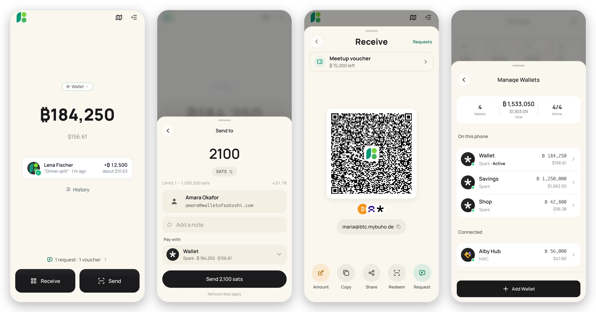
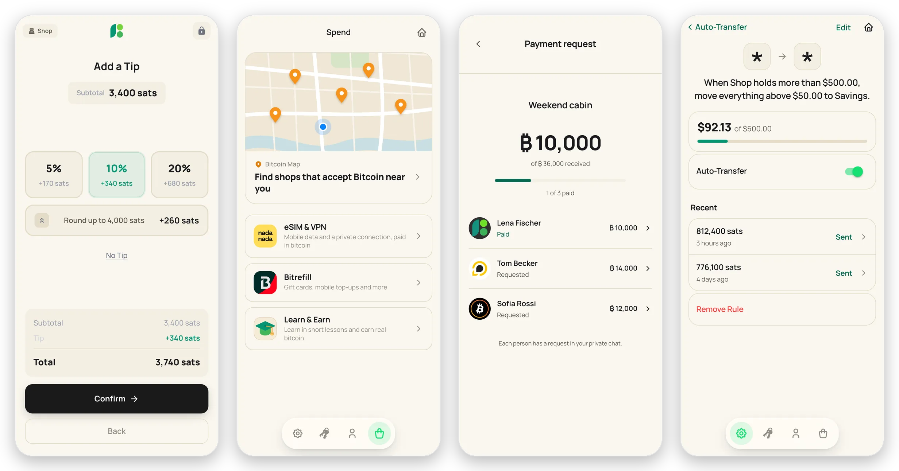

<div align="center">

# BuhoGO

**The friendly Bitcoin wallet. Hold your own keys, pay anyone, spend anywhere.**

[](https://go.mybuho.de)
[](https://play.google.com/store/apps/details?id=mybuho.buhogo)
[](https://zapstore.dev/apps/mybuho.buhogo)
[](https://hub.docker.com/r/robinvonmises/buho_go)
[](LICENSE)

[**Open the app**](https://go.mybuho.de) · [**Docs**](https://docs-buhogo.netlify.app/) · [**Developers**](#for-developers) · [**Contribute**](CONTRIBUTING.md)

<br>

<picture>
  <source media="(prefers-color-scheme: dark)" srcset=".github/media/hero-dark.webp">
  
</picture>

</div>

## What it is

BuhoGO is a self-custodial Bitcoin and Lightning wallet for web and Android. Create a wallet in seconds, or connect the one you already use, and pay anything from a Lightning invoice to a phone number. Your keys stay on your device: no sign-up, no email, no ID.

New here? [Getting started](https://docs-buhogo.netlify.app/getting-started) walks you through your first wallet and backup.

## Wallets

Use as many as you like, side by side, and choose which one pays.

| Wallet | Who holds the keys | Good for |
| --- | --- | --- |
| [**Spark**](https://docs-buhogo.netlify.app/spark-wallet) | You. Up to six wallets from one recovery phrase | Starting out: Lightning, on-chain Bitcoin, free transfers between Spark wallets |
| [**Arkade**](https://docs-buhogo.netlify.app/arkade-wallet) | You | Instant `ark1` transfers and on-chain Bitcoin on the Ark protocol. Its Lightning is paused while its provider moves to a new service. |
| [**NWC**](https://docs-buhogo.netlify.app/nwc-wallet) | The wallet you connect (Alby Hub, Primal and others) | Keeping the Lightning wallet you already have |
| [**LNbits**](https://docs-buhogo.netlify.app/lnbits-wallet) | Your own server | Running your own node |

## What you can do

- **Pay anyone.** Invoices, Lightning addresses, LNURL, Bitcoin and Spark addresses, Nostr profiles, and phone numbers in Kenya and Zambia. [How paying works](https://docs-buhogo.netlify.app/payment-scenarios)
- **Ask for money and split the bill.** One request to several people, in equal shares or by amount, and see who has paid. [Requests](https://docs-buhogo.netlify.app/features/requests)
- **Chat with your contacts.** Requests and payments in a private, end-to-end encrypted chat. [Contact chat](https://docs-buhogo.netlify.app/features/chat)
- **Spend it.** A map of places that take Bitcoin, eSIMs and VPNs, gift cards, and short lessons that pay real sats. [Spend](https://docs-buhogo.netlify.app/features/spend)
- **Run a shop.** Kiosk mode turns a phone into a point of sale with tips, round-up and Bolt Card payments. [Kiosk](https://docs-buhogo.netlify.app/features/kiosk) · [Bolt Cards](https://docs-buhogo.netlify.app/features/bolt-card)
- **Move money on its own.** Auto-Transfer sends what is above an amount to savings, a contact or an address, in sats or your currency. [Auto-Transfer](https://docs-buhogo.netlify.app/features/auto-transfer)
- **Be someone.** Nostr identities, a username, a public page to get paid, and Lightning login. [Identities](https://docs-buhogo.netlify.app/features/identities)
- **Stay safe.** Backups of your recovery phrase, app lock, and an emergency exit for Spark. [Backup](https://docs-buhogo.netlify.app/features/backup) · [Emergency exit](https://docs-buhogo.netlify.app/features/emergency-exit)

<div align="center">
<picture>
  <source media="(prefers-color-scheme: dark)" srcset=".github/media/features-dark.webp">
  
</picture>
</div>

Everything else, from batch payments to transaction reports, is in the [feature list](https://docs-buhogo.netlify.app/features). Light and dark theme; English, German and Spanish.

## Your keys, your coins

Recovery phrases are encrypted on your device and never leave it. Connection details for NWC and LNbits stay on the device too. Nobody at BuhoGO can see your balance, freeze your money or move it. Back up your recovery phrase: it is the only way back to your money. See [SECURITY.md](SECURITY.md) to report a vulnerability or verify a download.

## Get BuhoGO

| Platform | Where |
| --- | --- |
| Web | [go.mybuho.de](https://go.mybuho.de) |
| Android | [Google Play](https://play.google.com/store/apps/details?id=mybuho.buhogo) · [Zapstore](https://zapstore.dev/apps/mybuho.buhogo) · [GitHub releases](https://github.com/Buho-Ecosystem/Buho_go/releases) |
| Self-host | [Docker image](https://hub.docker.com/r/robinvonmises/buho_go) |

## For developers

Vue 3, Quasar, Pinia and Capacitor. Every wallet type sits behind one provider interface, so the screens never know which one they talk to.

```bash
git clone https://github.com/Buho-Ecosystem/Buho_go.git
cd Buho_go
npm install
npm run dev        # http://localhost:9000
npm test           # unit tests
npm run build      # dist/spa
```

| Read | For |
| --- | --- |
| [Developer.md](Developer.md) | Architecture, wallet providers, stores, building for Android |
| [Feature records](docs/README.md) | How a feature works and the rules that keep it right |
| [CONTRIBUTING.md](CONTRIBUTING.md) | Branches, pull requests, tests and checks |
| [CHANGELOG.md](CHANGELOG.md) | What changed in each release |

Pull requests go to `dev`; `main` is the released state.

## Support and credits

[Support BuhoGO on Geyser](https://geyser.fund/project/buhogo) · [Illustrations by Storyset](https://storyset.com/)

## License

[AGPL-3.0](LICENSE).
