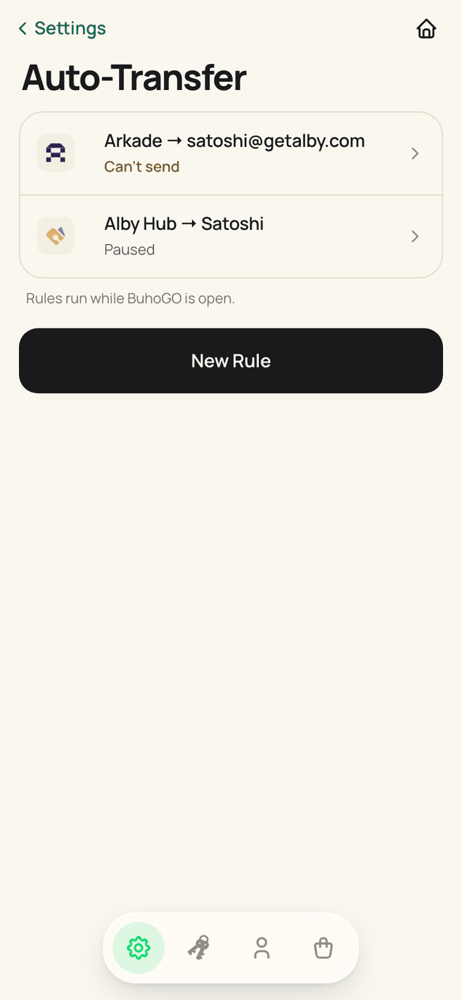
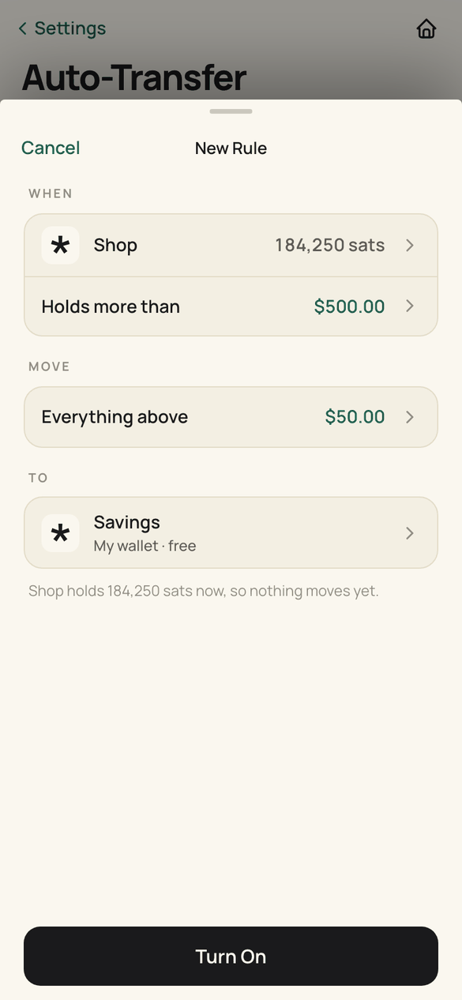
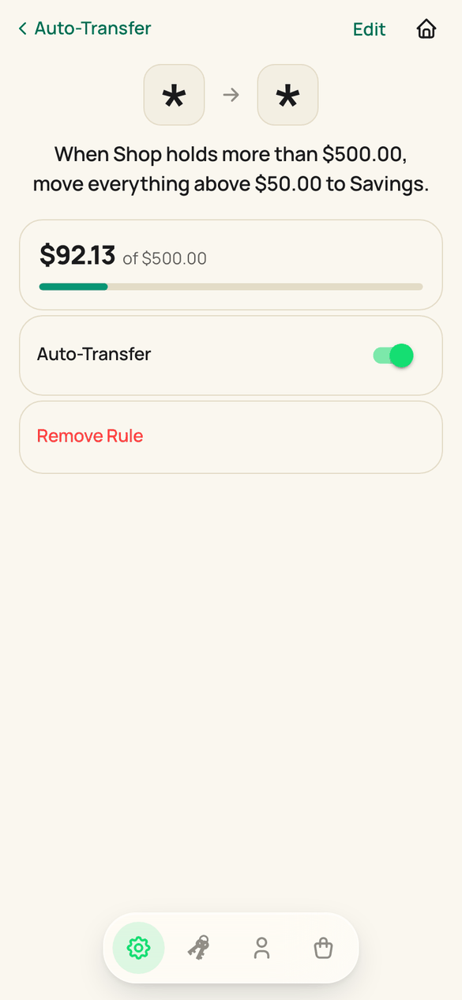
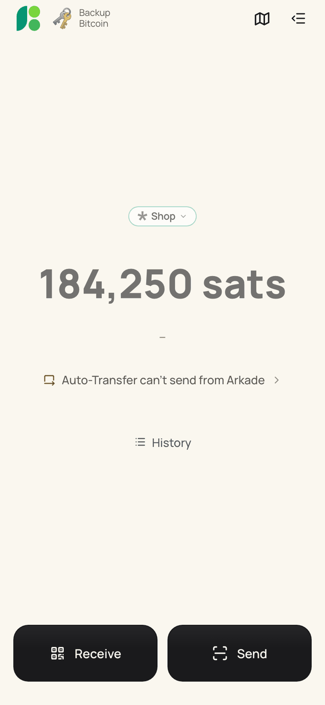

# Auto-Transfer

A rule moves money out of a wallet once it holds more than an amount. It reads as a sentence:

> When **Shop** holds more than **$500**, move everything above **$50** to **Savings**.

| Part | What it is |
|---|---|
| When | the wallet the rule watches (one rule per wallet) and the amount that starts a transfer |
| Move | everything, or everything above an amount kept in the wallet |
| To | another wallet on this phone, a contact, or a pasted or scanned address |

Amounts are kept the way they were typed, in sats or in a fiat currency.

## Where it lives

| Surface | File |
|---|---|
| Settings card → the rules | `pages/AutoTransferPage.vue` (`/auto-transfer`, `?new=<walletId>` opens setup) |
| One rule: sentence, meter, switch, recent activity, remove | `pages/AutoTransferRulePage.vue` (`/auto-transfer/:walletId`, `?edit=1`) |
| New Rule / Edit Rule sheet (When / Move / To, keypad, destination picker, speed) | `components/autoTransfer/AutoTransferSheet.vue` |
| Home: one line and a sheet when a rule needs the person | `components/autoTransfer/AutoTransferStatusLine.vue` |
| A wallet's details: "Auto-Transfer · To Savings" or "Set Up" | `components/settings/WalletDetailPanel.vue` |
| History row "To Savings", details "Type: Auto-Transfer ›" | `pages/TransactionHistory.vue`, `pages/TransactionDetails.vue` |

Words come from one place, `utils/autoTransferCopy.js`: a rule is a sentence, a status a few words, a reason one short sentence. No payment routes (Lightning, Spark, on-chain) and no "withdrawal". The only explanations are group footers, the way system settings explain themselves: the live footer in the sheet ("Shop holds 184,250 sats now, so nothing moves yet."), "Rules run while BuhoGO is open." under the list, and why a rule is paused under its switch.

## How a rule runs

`stores/autoWithdraw.js` runs a wallet's rule on every network-verified balance (`wallet.applyBalance`); the rules themselves are pure in `utils/autoTransfer.js`.

1. Below the amount that starts it: nothing. A fiat amount converts with a rate at most an hour old; without one the rule waits (`no_rate`) and never guesses.
2. Spark balances are re-read fresh before money moves; the rule, the wallet and its connection must be unchanged after the read.
3. The destination is checked again (`destinationProblem`): this wallet can pay it, it is not this wallet, no loop of rules sends the money back.
4. The amount: what is above the amount kept, less the fee. Spark to Spark is free (0 held back); Lightning holds back 1%, at least 10 sats; on-chain quotes the fee for the chosen speed and withdraws with the fee included.
5. Another wallet on this phone goes through `transferBetweenWallets`; addresses through the wallet's provider.
6. Every outcome lands in the rule's recent activity (20 events; repeated waits collapse into one line). The transaction is stamped `source: 'auto-transfer'` with the destination's name.

| Situation | What happens |
|---|---|
| Sent | toast "Moved 512,400 sats · To Savings"; 60 s before the rule runs again |
| Failed | no alert; Home's line "Auto-Transfer couldn't send to Savings ›"; retry after 15 s |
| Outcome unknown (NWC) | rests 10 minutes: it may have gone through |
| 5 failures in a row | the rule pauses itself; "Try Again" switches it back on and runs it |
| Destination wallet removed | the rule pauses: "Paused: where it sent is no longer on this phone." |
| Rule moved from an old Spark pocket | paused, and says so |

## Keeping balances current

A rule only runs when a verified balance arrives. Spark wallets get them from the Spark lifecycle, all of them, all the time. Other wallets (NWC, LNbits, Arkade) were read only for the active wallet while Home was open, so a rule on any other of them never ran. `services/autoTransferWatch.js` reads every wallet with a switched-on rule that Spark does not cover: every 60 seconds while the app runs, and once when the app comes back to the front.

## In the background

There is no background service. Measured on the Android 16 emulator with a debug build:

| App state | What happened |
|---|---|
| Open | the watch read the rule's NWC wallet every 60 s; the rule ran |
| Hidden, the first ~60-90 s | JavaScript kept running (`oom_adj 700`); one more round ran while hidden |
| After that | Android froze the cached app (`oom_adj 900`, `cch`); nothing ran, the WebView did not answer |
| Back in front | one read within about a second and the rule ran; the duplicate resume events (visibility, app state, resume and the thawed timer) are coalesced into that one read |

So a payment that arrives while the app is closed or frozen moves on the next return to the app. Running in the background would need an Android foreground service.

## Checking

- `node --test src/utils/__tests__/autoTransfer.spec.js src/stores/__tests__/autoTransferEngine.spec.js src/services/__tests__/autoTransferWatch.spec.js`
- `node scripts/check-auto-transfer.mjs` (dev server on port 9031): setup through the real sheet, destinations, attention on the list, page and Home, history, the wallet's details, dark, and the real chain from a verified balance through the engine and a wallet-to-wallet transfer to the toast, failures and recovery.
- On a device: `output/auto-transfer/device/` holds the timeline script used for the background check.

| Rules | Setup | A rule | Home |
|---|---|---|---|
|  |  |  |  |
