# Bolt Card

How BuhoGO takes money from a Bolt Card, in the wallet and at the kiosk, and the rules that keep it safe. A Bolt Card is an LNURL-withdraw link on an NFC card; its PIN follows the draft LUD-XX `pinLimit` (lnurl/luds#290).

## One surface, card in hand

The card shows up as an object the moment it touches the phone, and everything after the tap happens on that one surface: the amount, the PIN, the check, the result and every failure. The card, the amount and where the money goes stay on screen while the PIN is typed.

| Wallet | | | | |
|---|---|---|---|---|
| 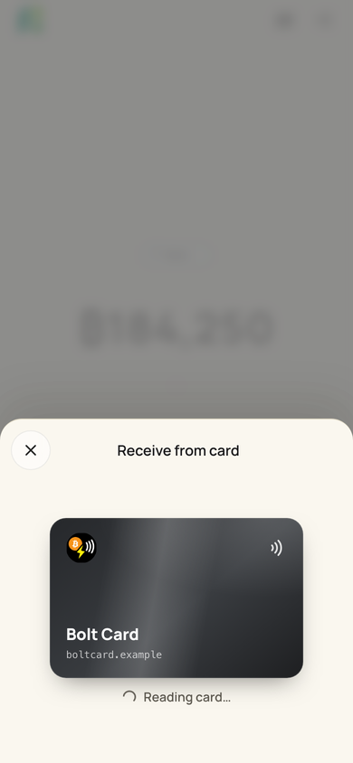 | 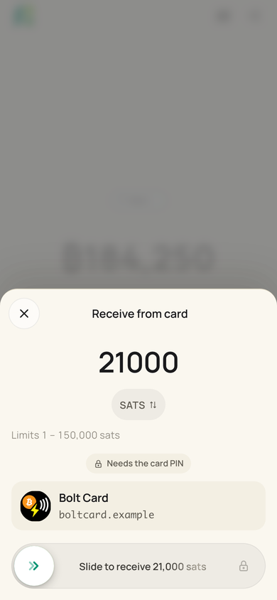 | 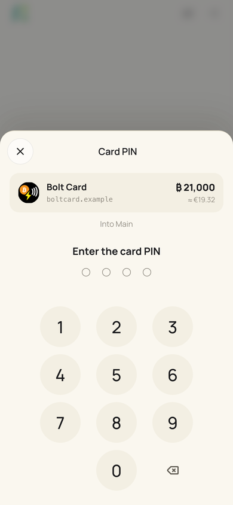 | 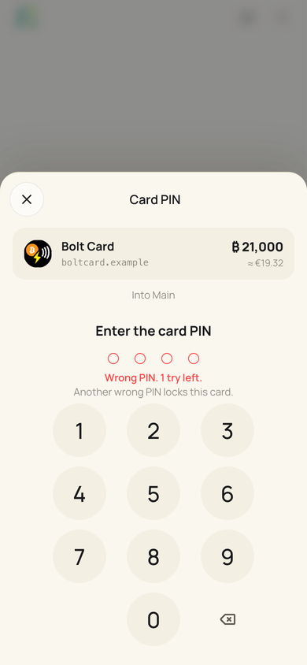 | 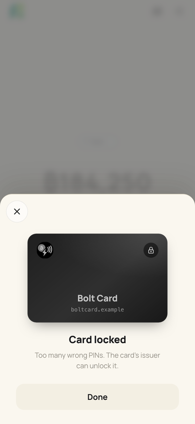 |

| Kiosk | | | | |
|---|---|---|---|---|
| 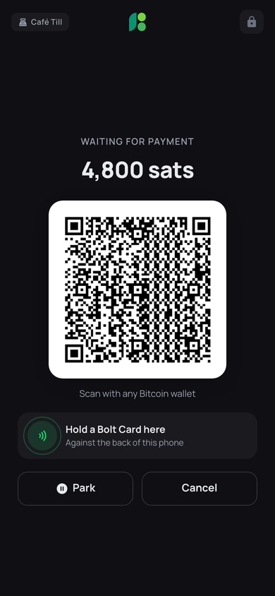 | 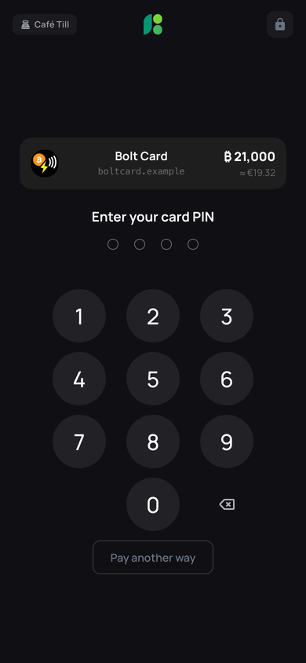 | 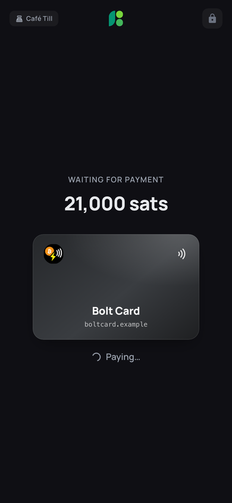 | 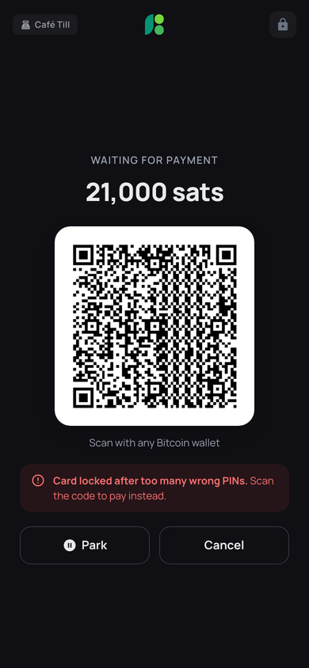 | 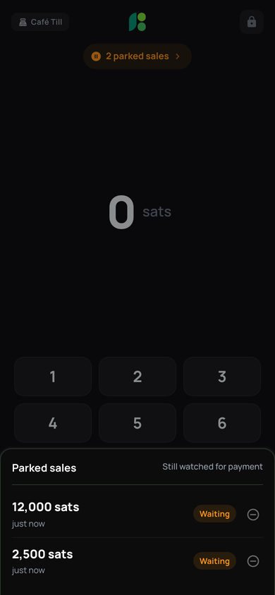 |

Before: the PIN took over the whole screen, the kiosk went back to its QR after the PIN, and a locked card was an error dialog.

| 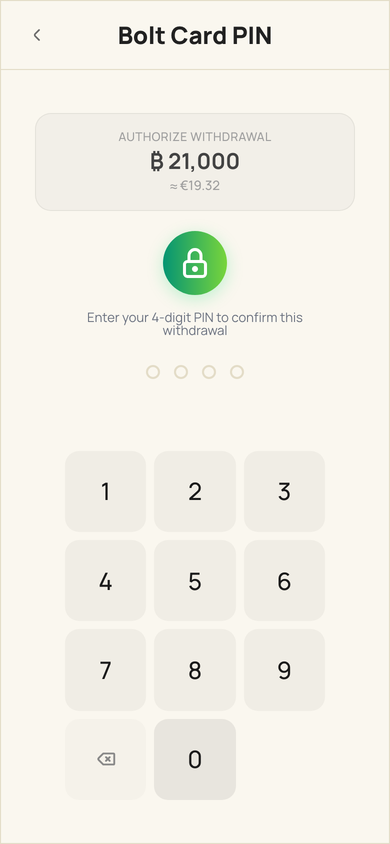 | 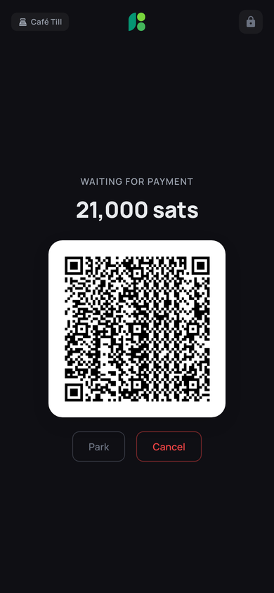 | 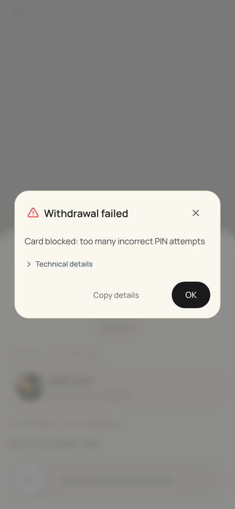 |
|---|---|---|

## Wallet: receive from a card

`src/pages/Wallet.vue` with `src/components/PaymentConfirmSheet.vue`.

- **The tap gets an answer at once.** An `lnurlw://` link opens the sheet before the card's service has answered: the card face (`CardFace.vue`) with "Reading card…". If the read fails, or the link is not a withdrawal after all, the sheet goes and the error shows as before.
- **Amount, then the slide.** A card always slides (`payment.card` forces it), in the receive tone. "Needs the card PIN" appears only once the amount reaches `pinLimit`, and the slide then ends at a lock, so the PIN is never a surprise. Nothing ever proposes an amount from `pinLimit`.
- **The PIN in the sheet.** `WithdrawAuthorization.vue` draws `CardPinPanel.vue` in the sheet's `takeover` slot: the card, the amount (LUD-XX: the amount must be on the PIN screen) and "Into {wallet}" stay on top. The fourth digit sends the PIN. While the service checks it, the dots pulse, the pad rests and the sheet's close button is disabled: the request is in flight and cannot be called back.
- **Wrong PIN:** the dots shake and clear with an error haptic, "Wrong PIN. 2 tries left.", then "Wrong PIN. 1 try left. Another wrong PIN locks this card."
- **Locked card:** a result in the sheet (grey card, "Card locked", who can unlock it, Done), not an error dialog. Nothing was sent, so there is nothing to copy for support.
- **Cancel** from the PIN sends nothing and returns to the amount and the slide.
- **The invoice** comes from `store.createInvoiceDetailsOnWallet`, the one way BuhoGO asks its own wallets to receive: one connection per wallet, NWC receive grants checked, a stale connection reconnected.

## Kiosk: pay with a card

`src/pages/KioskDashboard.vue` with `src/composables/useKioskCardPayment.js`. The page owns the sale; the composable reads the card and authorizes it against the sale's own invoice.

- **The pay screen offers the card**, next to the QR, when the device has NFC switched on ("Hold a Bolt Card here").
- **A tap on the pay screen pays at once**, like a terminal: the amount was on screen when the card touched the phone. When the amount reaches the card's PIN limit, the customer types the PIN on the same screen ("Pay another way" goes back to the QR without losing the sale).
- **A card tapped before there was a sale** is held for two minutes ("Card held · enter the amount"). After Charge it waits for an explicit "Charge card", because its holder never saw the amount.
- **The card stays on screen until the sale is paid** ("Paying…"). The sale's own payment watch decides paid, never the callback's OK.
- **A card that does not pay** says why in one line on the pay screen, with the QR still there: locked after wrong PINs, outside the card's limits, or no answer from the card's service (then the screen says that a payment, if it happened, still shows up). No dialog to dismiss at the counter.
- The success screen says "Paid by card" when the card paid.

## Parked sales

`src/composables/useKioskParkedSales.js`. Parking sets the sale on screen aside so the register can take the next customer. Parking never stops a sale from being paid, so it never stops it from being watched.

- **Several at once**, up to six. A seventh is refused with a notice; nothing is ever dropped to make room (before, a second park silently replaced the first).
- **Still watched.** Every parked sale is checked every few seconds and whenever the kiosk comes back to the front (paid means settled, `store.lookupInvoiceOnWallet`). A paid one leaves the list, is recorded as a kiosk sale on its incoming payment, and a toast says "Parked sale paid", whatever is on screen.
- **Saved on the device**, so a restart keeps every parked sale and its watch. Only invoice data is stored: nothing secret.
- **One quiet line** under the header: "2 parked sales ›", which pops when a sale is parked. It opens the list: amount, item count and age, Waiting or Expired.
- **Opening a parked sale** needs an empty register, so nothing typed is lost. An expired sale cannot be opened; it was checked once more after its expiry (paid just before still counts).
- **Removing** an expired sale is immediate. Removing one that can still be paid asks first: a later payment still reaches the wallet, but the kiosk will not show the sale.
- Cancelling the sale on screen, or switching the kiosk wallet, leaves parked sales alone.

## The slide

`src/components/SlideToSend.vue`, used by every payment that slides.

- The label shimmers at rest and fades as the thumb passes. The fill follows the finger with no lag.
- Near the end the thumb arms with a detent haptic: letting go there completes. A quick flick past halfway completes too; a finger that stopped before lifting did not flick. Anything else springs back from where it was let go.
- `tone="receive"` uses the brand green for money coming in. `lockAtEnd` shows the lock when a PIN follows.
- The control is a button for keyboards and screen readers: Enter, Space, or the screen reader's activate gesture run the same slide. Reduce Motion drops the shimmer and the springs.

## Rules kept

- Compare in millisats: `amount × 1000 ≥ pinLimit`. Exactly four digits.
- One callback per attempt, never retried on its own; a network error is uncertain, never "paid" and never "failed".
- https is required for a callback that carries a PIN. PINs and card parameters stay out of logs and error text (`safeWithdrawError`).
- Three tries: "Invalid PIN" and "Card blocked" come from the service's reasons; the third wrong PIN reads as locked.

## Checks

- `node --test src/components/__tests__/withdrawAuthorization.spec.js src/composables/__tests__/kioskCardPayment.spec.js src/pages/__tests__/kioskPayments.spec.js`
- `node scripts/check-boltcard.mjs` against a running dev server (`pnpm dev --port 9031`): drives both flows through the app against a stand-in card service and writes screenshots to `output/boltcard-check/`.
