# Bolt Card

How BuhoGO takes money from a Bolt Card, in the wallet and at the kiosk, and the rules that keep it safe. A Bolt Card is an LNURL-withdraw link on an NFC card; its PIN follows the draft LUD-XX `pinLimit` (lnurl/luds#290).

## One surface, card in hand

The card shows up as an object the moment it touches the phone, and everything after the tap happens on that one surface: the amount, the PIN, the check, the result and every failure. The card, the amount and where the money goes stay on screen while the PIN is typed.

| Wallet | | | | |
|---|---|---|---|---|
| 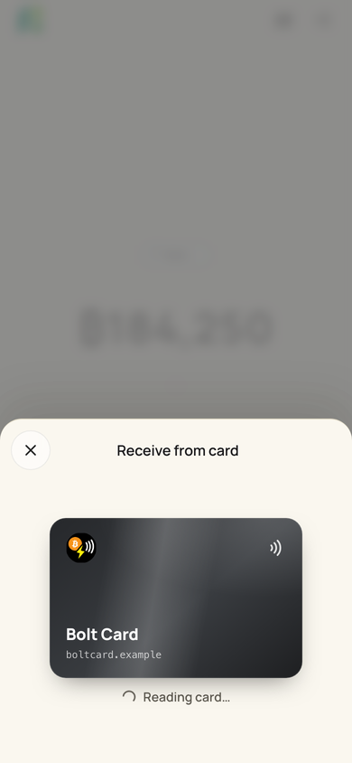 | 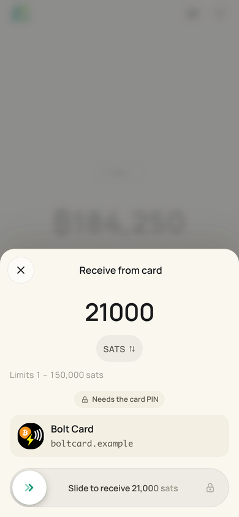 | 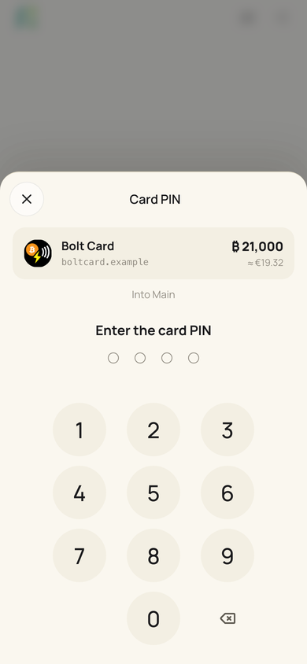 | 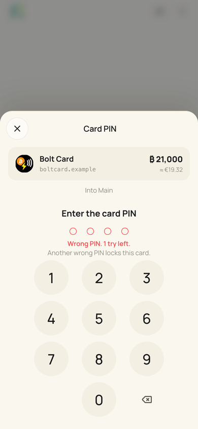 | 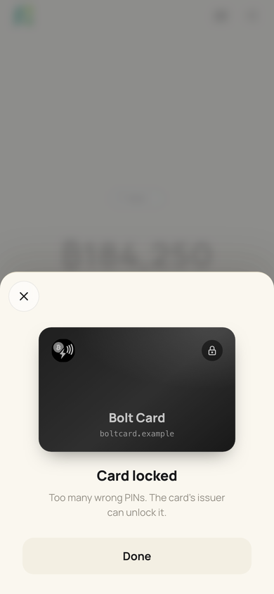 |

| Kiosk | | | | | |
|---|---|---|---|---|---|
| 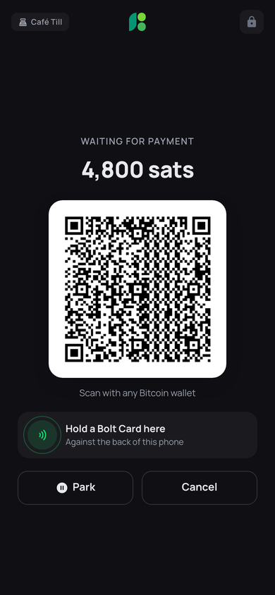 | 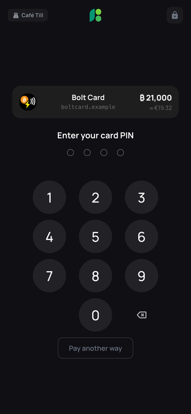 | 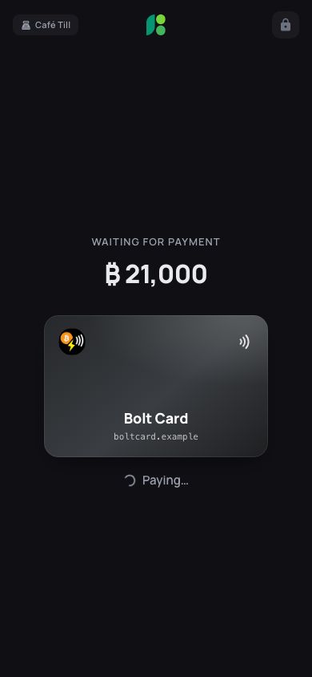 | 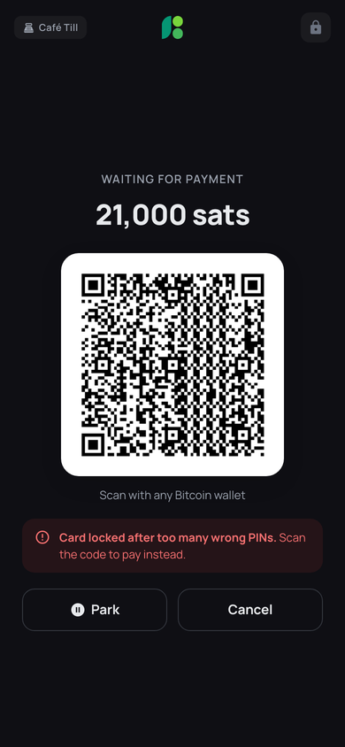 | 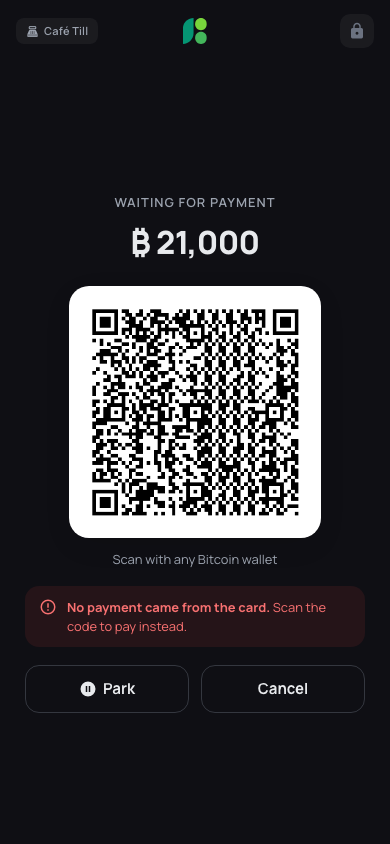 | 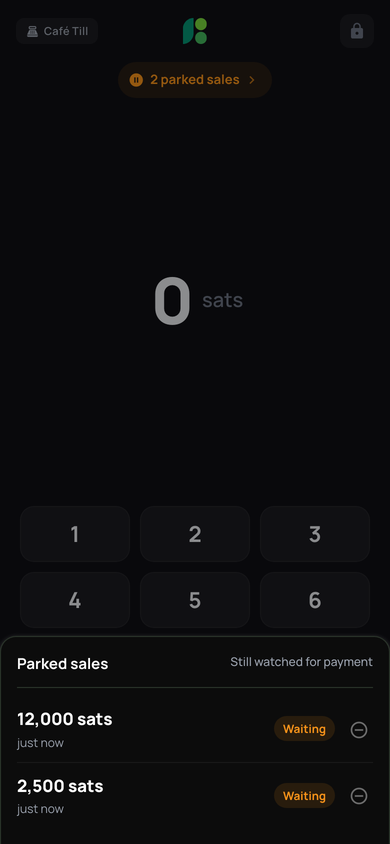 |

Before: the PIN took over the whole screen, the kiosk went back to its QR after the PIN, and a locked card was an error dialog.

| 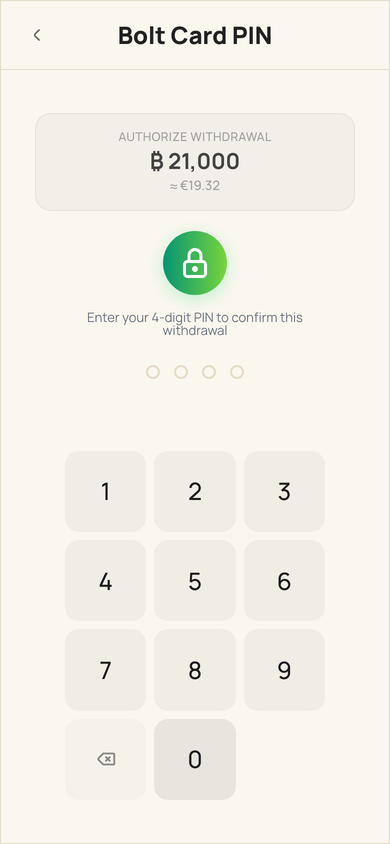 | 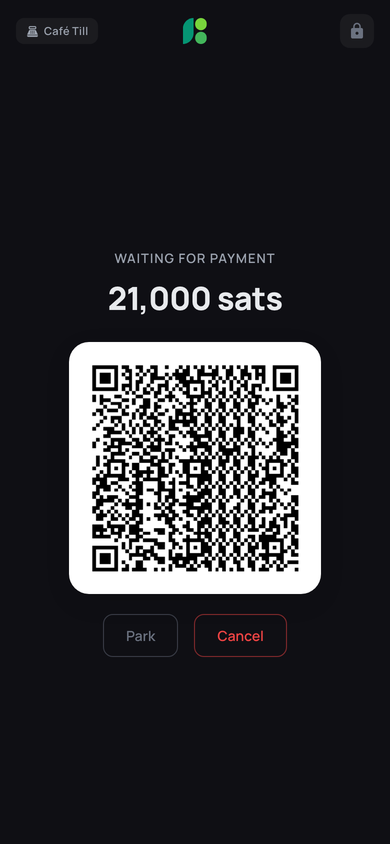 | 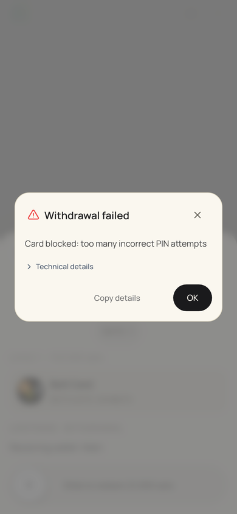 |
|---|---|---|

## Wallet: receive from a card

`src/pages/Wallet.vue` with `src/components/PaymentConfirmSheet.vue`.

- **The tap gets an answer at once.** An `lnurlw://` link opens the sheet before the card's service has answered: the card face (`CardFace.vue`) with "Reading card…". If the read fails, or the link is not a withdrawal after all, the sheet goes and the error shows as before.
- **Amount, then the slide.** A card always slides (`payment.card` forces it), in the receive tone. "Needs the card PIN" appears only once the amount reaches `pinLimit`, and the slide then ends at a lock, so the PIN is never a surprise. Nothing ever proposes an amount from `pinLimit`.
- **The PIN in the sheet.** `WithdrawAuthorization.vue` draws `CardPinPanel.vue` in the sheet's `takeover` slot: the card, the amount (LUD-XX: the amount must be on the PIN screen) and "Into {wallet}" stay on top. The fourth digit sends the PIN. While the service checks it, the dots pulse, the pad rests and the sheet's close button is disabled: the request is in flight and cannot be called back.
- **Wrong PIN:** the dots shake and clear with an error haptic, "Wrong PIN. 2 tries left.", then "Wrong PIN. 1 try left. Another wrong PIN locks this card."
- **Locked card:** a result in the sheet (grey card, "Card locked", who can unlock it, Done), not an error dialog. Nothing was sent, so there is nothing to copy for support.
- **Cancel** from the PIN sends nothing and returns to the amount and the slide.
- **The invoice** comes from `store.createInvoiceDetailsOnWallet`, the one way BuhoGO asks its own wallets to receive: one connection per wallet, NWC receive grants checked, a stale connection reconnected.

## Kiosk: pay with a card

`src/pages/KioskDashboard.vue` with `src/composables/useKioskCardPayment.js`. The page owns the sale; the composable reads the card and authorizes it against the sale's own invoice.

- **The pay screen offers the card**, next to the QR, when the device has NFC switched on ("Hold a Bolt Card here").
- **A tap on the pay screen pays at once**, like a terminal: the amount was on screen when the card touched the phone. When the amount reaches the card's PIN limit, the customer types the PIN on the same screen ("Pay another way" goes back to the QR without losing the sale).
- **A card tapped before there was a sale** is held for two minutes ("Card held · enter the amount"). After Charge it waits for an explicit "Charge card", because its holder never saw the amount.
- **The card stays on screen while it pays** ("Paying…"), for at most a minute after its service answered OK (`CARD_PAYMENT_WAIT_MS`). That OK only accepts the request: the service pays afterwards (LUD-03), and one whose wallet has no funds or no route never pays (#460). The sale's own payment watch decides paid, never the callback's OK, and it keeps running after the card lets go, so a later payment still completes the sale. When the minute is over, the sale is checked once more before the card lets go (`LAST_CHECK_MS`), so a payment that came while the phone slept, or since the last check, completes the sale instead of a line saying none came. An invoice that expires while the card waits lets go of the card too.
- **A card that does not pay** says why in one line on the pay screen, with the QR, Park and Cancel back: locked after wrong PINs, outside the card's limits, no answer from the card's service (then the screen says that a payment, if it happened, still shows up), or no payment within the minute ("No payment came from the card."). The next tap tries the same invoice again. No dialog to dismiss at the counter.
- The success screen confirms the receiving wallet settled the invoice. It does not infer whether the customer paid through the card or the QR.

## Parked sales

`src/stores/kioskMerchant.js` and `src/composables/useKioskPayments.js` retain each sale and all of its issued requests. Starting the next customer detaches the screen without deleting the original sale or stopping payment checks.

- **Durable before display.** The register saves an immutable item and amount snapshot, then its request identity, in IndexedDB before showing a QR. A storage failure keeps the request hidden until it can be saved.
- **Checked by exact identity.** Every issued request remains associated with its receiving wallet and payment hash. A restart restores waiting requests; expiry changes the display but late payments still reconcile to the original sale.
- **Safe replacement.** A replacement request for an expired sale first checks all earlier requests. Unknown creation results cannot be retried blindly. Distinct payments against two attempts remain visible as a duplicate-payment exception on one receipt.
- **Separate from saved baskets.** An unfinished basket has no invoice and may be saved for later. Issued requests retain their original item prices and cannot be deleted by clearing the next customer's basket.
- Existing parked invoice records migrate once into this register. The previous local-storage key is retained as a recovery copy.

## The slide

`src/components/SlideToSend.vue`, used by every payment that slides.

- The label shimmers at rest and fades as the thumb passes. The fill follows the finger with no lag.
- Near the end the thumb arms with a detent haptic: letting go there completes. A quick flick past halfway completes too; a finger that stopped before lifting did not flick. Anything else springs back from where it was let go.
- `tone="receive"` uses the brand green for money coming in. `lockAtEnd` shows the lock when a PIN follows.
- The control is a button for keyboards and screen readers: Enter, Space, or the screen reader's activate gesture run the same slide. Reduce Motion drops the shimmer and the springs.

## Rules kept

- Compare in millisats: `amount × 1000 ≥ pinLimit`. Exactly four digits.
- One callback per attempt, never retried on its own; a network error is uncertain, never "paid" and never "failed".
- https is required for a callback that carries a PIN. PINs and card parameters stay out of logs and error text (`safeWithdrawError`).
- Three tries: "Invalid PIN" and "Card blocked" come from the service's reasons; the third wrong PIN reads as locked.

## Checks

- `node --test src/components/__tests__/withdrawAuthorization.spec.js src/composables/__tests__/kioskCardPayment.spec.js src/pages/__tests__/kioskPayments.spec.js`
- `node scripts/check-boltcard.mjs` against a running dev server (`pnpm dev --port 9031`): drives both flows through the app against a stand-in card service and writes screenshots to `output/boltcard-check/`.
