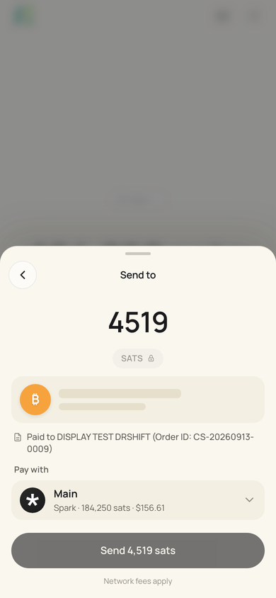
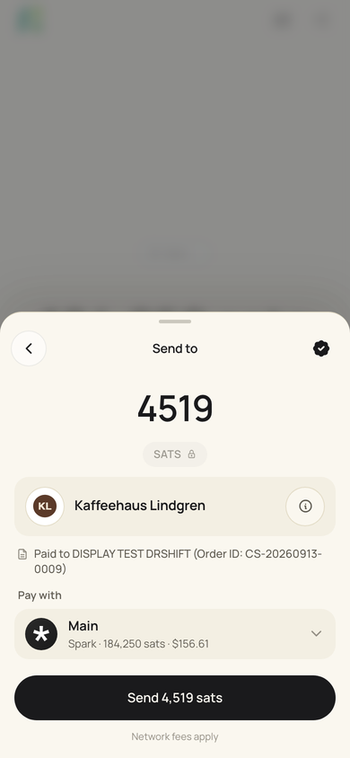
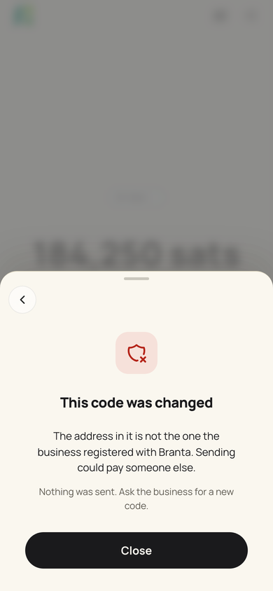
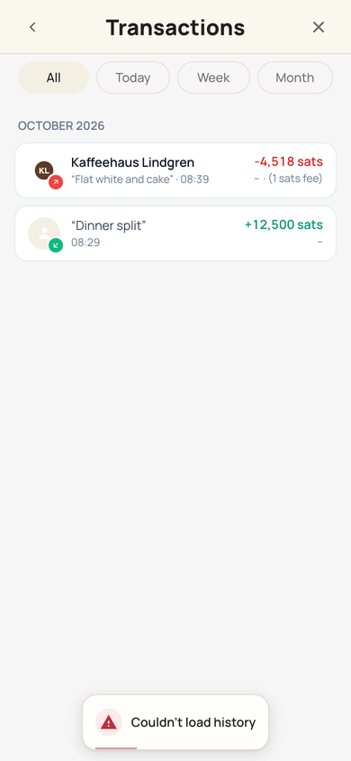
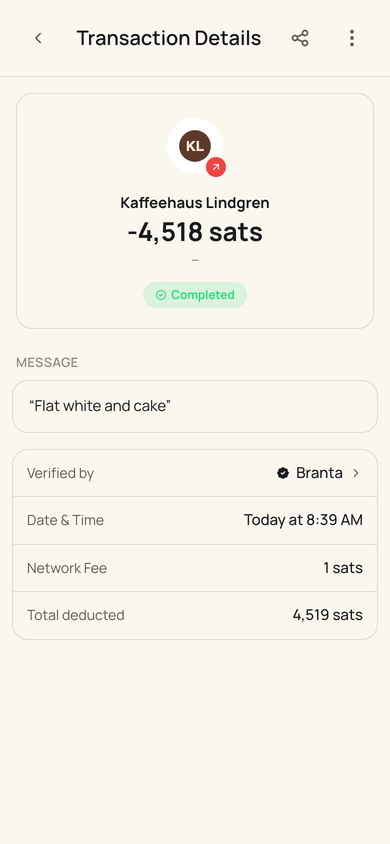

# Merchant verification (Branta)

Before you pay, BuhoGO asks [Branta](https://branta.pro) whether the destination belongs to a business that registered it. If it does, the business is who you pay: its logo and name replace the recipient, and a seal in the sheet's top bar opens Branta's verification page. If it does not, nothing is shown. A miss is the normal case and never an error.

One answer is never silent: a **changed code**. The code shows an on-chain address, but Branta's key in that same code says the business registered another one. The payment stops.

## What is checked

The lookup is strict and private. The SDK hashes and encrypts the destination on the phone, so the destination itself is never sent; `utils/branta.js` → `brantaLookupText` picks what to check.

| Payment | Checked |
|---|---|
| A code carrying Branta's key (`branta_id` + `branta_secret`) | The whole code: every part, and whether its address was changed |
| Lightning invoice | The invoice |
| Ark address | The address |
| Unified code without Branta's key | Only the part BuhoGO pays, when that is an invoice or an Ark address. Nothing ties the parts together, so a verified invoice says nothing about the Ark or Spark address paid instead |
| Lightning address, LNURL, Spark, plain on-chain, BOLT12 | Not checkable in strict mode |
| Your own users' invoices (public page `/p/`, chat requests, Waiting for you: `firstParty`), curated retail merchants | Skipped: never on Branta |

Every way in carries the original text (`rawInput`) so a code's key survives: the Send field, the Home clipboard line, links, NFC tags, the redeem scanner.

## On the confirm sheet

`Wallet.vue` → `runBrantaVerification` starts before the sheet opens and keeps one state on the payment, `payment.branta`:

| State | The sheet |
|---|---|
| `checking` | The recipient row keeps its place and pulses; the commit control waits. At most `BRANTA_HOLD_MS` (1.5 s) |
| `verified` | Logo and name are the recipient (a saved contact's name too), the raw destination moves behind the info button, the seal sits top right (`BrantaVerifiedBadge`, 44 pt, opens the page in the in-app browser) |
| `none` | The normal recipient. A miss, an error, no answer within the hold |
| `tampered` | `BrantaChangedCode` takes over the sheet: no business, no way to send, Close drops the payment |

The sheet settles once. A verified answer after the hold is ignored, so nothing changes under a finger. Only `tampered` still counts after the hold, until the payment is on its way. Changed codes and errors are never cached; answers are, per session.

The logo: `brantaAvatar` takes Branta's light-background logo for the white avatar plate, or its dark-background logo on a dark plate when that is the only one.

## After sending

`brantaReceipt` keeps `{ name, logoUrl, logoLightUrl, description, verifyUrl }` with the payment, on every send path (Spark on-chain withdrawals included), through the pending-link queue in `stores/transactionMetadata.js`. A verification has no address to prove which payment it belongs to, so the amount must match, and a payment stamped with one is never claimed again.

| Where | Shows |
|---|---|
| Paid screen | A pill: logo, "To {business}", seal |
| History | The business's name and logo as the row's title and avatar, no seal |
| Transaction Details | Logo and name at the top; "Verified by · Branta ›" opens the page again |

## Settings

Settings → Advanced → Merchant verification, on by default (`bitcoinPreferences.brantaVerificationEnabled`). The section footer says what it does when on, with a link to Branta.

## Debugging

localStorage `branta_debug` = `1` logs lookups; `branta_env` = `staging` uses Branta's staging service, which only knows Branta's example codes. Both are read at the first lookup.

## Checking

- `node --test src/utils/__tests__/branta.spec.js`: what is checked, logos, verified, changed code, errors.
- `node src/stores/__tests__/transactionMetadata.spec.js`: a verification lands only on the payment with its amount.
- `node scripts/check-branta.mjs` (dev server on port 9032): Branta is a local stand-in. Checking then verified, light and dark; a slow answer; a changed on-chain code decrypted by the real SDK; switched off and first-party (no lookup); paid screen, History, details; Settings.

| Checking | Verified | Changed code | History | Details |
|---|---|---|---|---|
|  |  |  |  |  |
