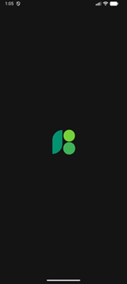
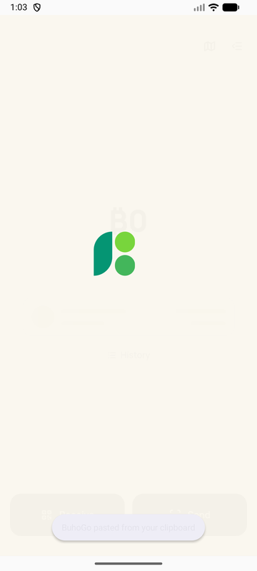
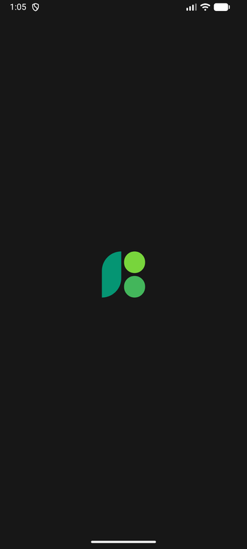
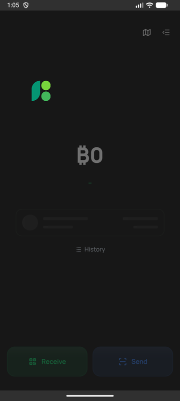
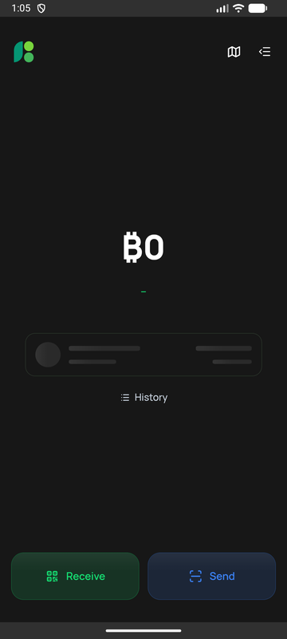

# Launch

What a person sees between tapping the BuhoGO icon and holding their wallet, and the rules that keep it one picture.

## One picture, start to finish

The system splash, the page before the app runs, and the app's first frame all draw the same thing: the mark, centred, 72 px (dp) wide, on the home screen's own background (cream, or #171717 in dark). The mark then travels into its place in the toolbar while the home screen rises in beneath it. No text, no loading dots, no second logo.

| Android 12+ builds the mark | | | Light: hand-over | Dark: splash | Dark: hand-over | Dark: home |
|---|---|---|---|---|---|---|
|  |  |  |  |  |  |  |

Before: a white splash (in dark mode too), then the welcome page's own loading screen with status text, then grey skeleton bars. Three backgrounds and a logo that jumped in size and place.

## Fast and slow

`src/components/LaunchMark.vue`, mounted by the first home screen of a session (`src/pages/Wallet.vue`).

- **Fast** (the saved wallets load within 350 ms): the mark travels straight to the toolbar in one transform, about half a second, while the background lifts off the home screen.
- **Slow** (a cold start): the three shapes of the mark breathe in turn, the mark as the loading indicator, until the wallets are in; then it travels the same way.
- **On Android 12 and later**, a cold start also builds the mark inside the system splash: the leaf grows from its base, then the dots pop in (`drawable-v31/launch_icon.xml`, 820 ms).
- **Reduce Motion:** no travel and no breathing, a short fade.
- The balance follows the app-wide rule: the home screen never shows a figure it does not know; an unloaded balance pulses in place.
- Only the first home screen of a session plays the launch (`claimLaunch`); coming back home never replays it.

## The hand-over

`src/utils/launch.js`, `src/boot/launch.js`, `index.html`, `LaunchPlugin.java`.

- **Android:** `MainActivity` installs the SplashScreen API and holds the splash until the app reports that the identical frame is on screen (`Launch.ready()`), then removes it without the system's exit animation, so nothing visibly changes. It waits at least for the build-up to finish, and never more than 8 s (a page that never loads still appears). `ready()` resolves once the splash is gone, so the mark only starts moving when it can be seen.
- **The page before the app runs:** `index.html` draws the same frame from the first byte, in the stored theme, and sets the page background so nothing is ever white. The WebView's own background is the launch colour too.
- **Opening elsewhere** (the welcome screen, the kiosk, a deep link): the launch boot releases the frame and the splash once that screen has painted.
- **The theme:** BuhoGO chooses light or dark itself (`buho.theme`, light by default), not the system. Every start and every change tells Android (`UiModeManager.setApplicationNightMode`, Android 12+), so the next splash is drawn in the app's theme. Android 11 and earlier follow the system's night mode.

## Returning people never see the welcome screen

A person with a saved wallet is sent to `/wallet` by the router before the welcome screen mounts (`savedWalletRedirect`). A saved state that cannot be read is left where it is (the wallet store sets it aside) and the welcome screen stays. The welcome screen no longer has a loading screen or status text of its own.

## Checks

- `node --test src/utils/__tests__/launch.spec.js`
- `node scripts/check-launch.mjs` against a running dev server (`pnpm dev --port 9031`): the hand-over and travel in light and dark, no replay, no welcome screen for a returning person, a first run, breathing while slow, Reduce Motion. Screenshots go to `output/launch-check/`.
- On a device: a cold start in light and dark (Settings theme), with a wallet and on a first run. The build-up only shows on a cold start of Android 12 or later.
