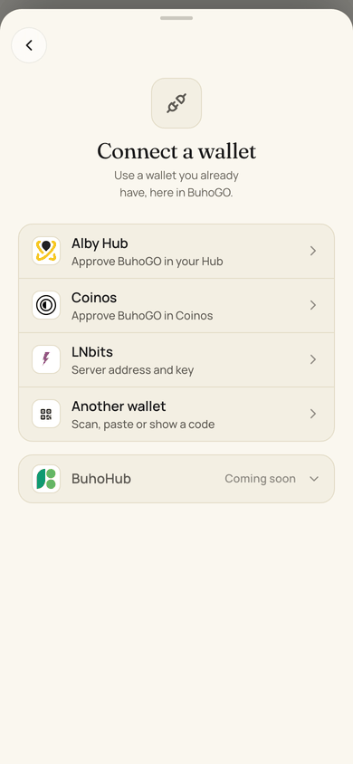
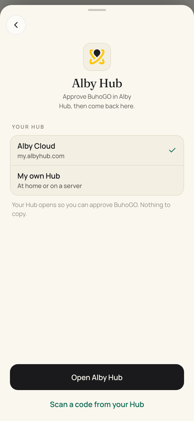
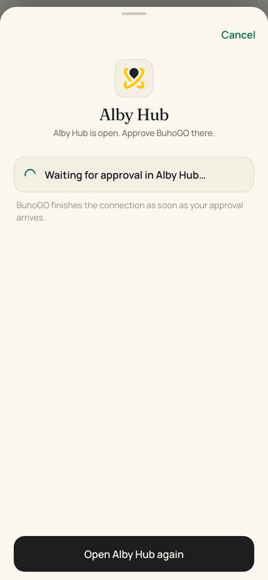
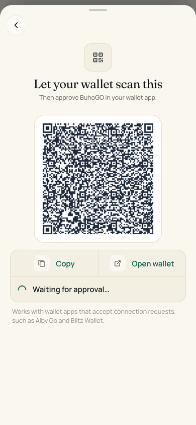
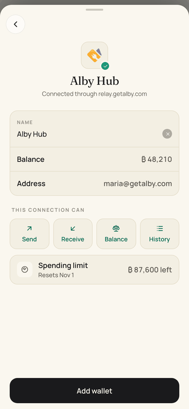

# Nostr Wallet Connect

How BuhoGO connects to a wallet over Nostr Wallet Connect (NIP-47) as a client, and the rules that keep it honest.

## Connecting: test first, name second

`src/pages/NWCSetupPage.vue`, steps in `src/components/nwc/`, all drawn by `src/components/sheets/FormSheetStep.vue`:

- **Connect** (`NWCConnectStep`): paste or scan. The connection string carries a secret that can spend, so the field is hidden like a password, with a reveal toggle.
- The connection is tested before anything is saved (`src/services/nwcProbe.js`): `get_info`, then `get_balance` and `get_budget` only when the connection may call them. A wallet that does not answer at once is asked again, because it may be an app on a phone that wakes by push; the button says "Waiting for your wallet…" meanwhile. A connection that may not call `get_info` reads its grants from the wallet's info event (kind 13194).
- **Found** (`NWCWalletFound`): the wallet's own name (alias, else the name in its Lightning address), balance or "Not shared", address, what the connection may do (`NWCCapabilities`) and its spending limit. A connection that cannot send or receive is still added, with the gap said.
- **Duplicate** (`NWCDuplicateStep`): the same wallet already here, matched by its key or Lightning address (`findSameWallet`), not by connection text. A second connection to the same wallet stays possible ("Add anyway"); the very same connection does not.
- **Problem** (`NWCConnectProblem`): which part did not answer, the relay or the wallet behind it.

Every relay in the connection string is kept (`src/utils/nwcConnection.js`); extra relays are backups. Pasted and scanned strings are stored in one normalized form.

A connection can also arrive from outside the sheet: a `nostr+walletconnect://` link from another app ("Connect" in a wallet; the Android filter lists the scheme and its no-`+` form), or one scanned or pasted on Home, where the field reads "Wallet connection". `src/services/nwcConnectionIntake.js` hands it to the sheet in memory, once, never in the route (the string can spend), and the sheet tests it at once; an open sheet takes a new one directly. A link does nothing in kiosk mode.

## Choosing a wallet, and pairing without a secret

"Connect a wallet" (`/connect-wallet`; one row in Settings' Add New Wallet and in Welcome's "More ways to start") first asks which wallet (`ConnectWalletChooser`): Alby Hub, Coinos, LNbits (its own sheet), or another wallet (the paste and scan step above). BuhoHub sits apart as a note that it is coming; a tap says what it is, nothing more. `/nwc-setup` still opens straight at paste and scan, for links and Home.

Alby Hub, Coinos and the code never show a secret. BuhoGO makes the connection's key pair, keeps the request encrypted with the device key for 15 minutes, one at a time (`src/services/nwcPairing.js`), and the wallet answers with its own key and relays. The answer becomes an ordinary connection string (`src/utils/nwcPairing.js`), which goes through the same test and "Wallet found" as a pasted one. A request is taken once, by whichever answer arrives first, so one approval never adds a wallet twice.

- **Alby Hub** (`WalletApproveStep`, entry `albyhub`): Alby Cloud (`my.albyhub.com`) or the person's own Hub by address (remembered). BuhoGO opens `<hub>/apps/new` with its public key, the methods it uses and `return_to=https://go.mybuho.de/nwc/connected?request=<id>`. The Hub answers twice: it publishes an info event (kind 13194) addressed to our key on its relays (`relay.getalby.com`, `relay2.getalby.com`), which BuhoGO listens for while waiting, and it sends the person back to the return address with its relays, key and Lightning address. On the web the Hub opens in the same tab and the return finishes the request; in the app it opens in the in-app browser (`@capacitor/browser`, now also in `src-capacitor/package.json`), so the person never leaves BuhoGO, and the return is an App Link (`/nwc/connected`, next to `/p/`). When the browser keeps it, that page offers "Open BuhoGO" (an intent link with the package), and the relay answer usually finished it already. The Hub signs in or unlocks first and keeps the link through that.
- **Coinos** (entry `coinos`): its approval page (`coinos.io/apps/new?pubkey=…`) neither returns nor announces. Coinos serves every connection from one wallet key on `wss://relay.coinos.io`, so the connection is known up front; BuhoGO asks it `get_info` until Coinos knows the key (an answer, or "not allowed"), which is the approval. Checked with a real account (2026-10-19): before approval Coinos answers "unknown connection" within a second; after Submit BuhoGO noticed within 3 s. Coinos calls itself `ln.coinos.io` and shares no Lightning address, so the wallet is named "Coinos".
- **A code** (`WalletAuthCodeStep`, NWC-08 client-initiated connection): a `nostr+walletauth://` request with our key, a `state`, the methods (`get_budget` optional) and the Hub relays, shown as a QR code, copyable, and openable on this phone. Wallets that create connections on a Hub (Alby Go) answer on the Hub relays without `state`; wallets that follow NWC-08 (Blitz Wallet) answer on the given relays with it and may name other relays. An answer must name our key and carry our `state`; one without `state` counts only from a Hub relay. Its signature is checked.

- **A wallet app on this phone** (entry `walletapp`, `offered`): the Android app asks the system which apps can open `nostr+walletauth` (`WalletAppsPlugin`, the scheme declared in the manifest's `<queries>`; `services/walletApps.js`). If any, the row names them ("Alby Go") and one tap opens the request with `return_to=buhogo://nwc/connected?request=<id>`, a custom scheme so it needs no App Link verification; a code shown as a QR never carries it. Alby Go opens `return_to` after approving; Blitz Wallet does not read it, so there the person switches back by hand (the relay answer has finished the connection by then). A return names only the request: it brings the waiting step back, also after Android closed BuhoGO (`resumePairing`). In the web app on an Android phone the row explains that this works in BuhoGO for Android, with the Google Play and Zapstore badges (`StoreBadges`, links from `services/appUpdate.js`) and "Show a code instead"; elsewhere it is not offered. Checked on an Android 16 emulator with Alby Go 2.1.0 installed: found by name, opened with the request, and a return to a closed BuhoGO resumed the wait.

Links that open BuhoGO from outside (`boot/deep-links.js`) wait for the router's first navigation before they navigate: on a cold start the link arrives first, and the start screen used to replace it (card links too).

The SDK's own client-initiated connection (`NWAClient`) is not used: it sends no `state`, which NWC-08 wallets require, and accepts any info event naming the key.

### Adding a wallet

The chooser, the approval step and the pairing never name a wallet; they read `src/utils/connectWallets.js`. To add one (BuhoHub when it opens, another Hub, another custodian):

1. One entry in `CONNECT_WALLETS`: `id`, `name`, `logo`, `subtitle`, and how it pairs (`pairing`):
   - `approve-and-return`: an approval page that takes `pubkey` and `return_to` and announces on its relays (Alby Hub's `/apps/new`). Set `approval.path`, `locations` and/or `selfHosted`, `relays`, and `appId` if it lists BuhoGO.
   - `approve-known`: an approval page that takes `pubkey` only, for a wallet that serves every connection from one key. Set `approval.url`, `path`, `walletPubkey`, `relay`.
   - `sheet`: its own setup sheet (`route`).
   - `soon: true` with `about`: shown apart as a note until it opens.
2. The logo in `public/` and the entry's strings in `src/i18n/{en-US,de,es}/nwc.js`.
3. `node --test src/utils/__tests__/connectWallets.spec.js` says what is missing (logo file, a string in a locale, a relay, a key).

A wallet that changes its approval page (Coinos is moving to a new version) changes only its entry.

Screens (`docs/images/connect-wallet/`, from `scripts/check-nwc-pairing.mjs`):

| Chooser | Alby Hub | Waiting | Code | Found |
|---|---|---|---|---|
|  |  |  |  |  |

The return route with nothing waiting for it says so ("Nothing is waiting for this approval"), or, in an Android browser, offers to finish in the app. In kiosk mode these routes stay setup routes and links do nothing, as before.

## One relay connection per wallet

An NWC wallet keeps one relay connection while the app runs (#395). The store owns it (`connectionStates[id].nwcInstance`), and every screen and service asks for it with `store.nwcConnection(walletId)` instead of building a `NostrWebLNProvider` of its own: Home, history and its pages, a transaction, Receive (invoice and payment check), sends, batch sends, Auto-Transfer, internal transfer, kiosk, Social Bucket and Learn & Earn. `LightningPaymentService` takes that connection and never closes it; reading a payment input (Lightning address, LNURL, invoice) needs none.

- **One connect at a time:** two askers while it is being made share the same attempt. Connecting again closes the connection it replaces.
- **Nothing left open:** a connect that fails is closed. One that outlives a disconnect or a removal (the wallet's epoch moved) is closed and refused, never handed out. Disconnect and removal close the wallet's connection.
- **Dropped relays:** the SDK opens the socket on the first request and reconnects a dropped relay on the next one, giving up on a relay after 3 s, so the same connection survives a phone losing the network or the app going to the background. A notification subscription reconnects each relay on its own ([Incoming payments](INCOMING_PAYMENTS.md)).
- **Short-lived on purpose:** the connection test before adding (`nwcProbe`), the pairing check (`walletKnowsConnection`) and the tax report (`NWCWalletProvider`, reads across wallets) each open their own and close it when done.

Measured with a stand-in wallet (`scripts/check-nwc-connections.mjs`): before, one wallet held 9 connections after Home, two history pages, a transaction, Receive, a send and a batch of 3; now it holds 1 throughout, reconnects once after the relay drops it, and none after removal. On an Android 16 emulator (debug build, stand-in wallet on a public relay via `scripts/device/nwc-stand-in.mjs --relay …`): one connection from start through Home, history and a transaction; after 25 s in the background with the network off it reconnected once on the next request; none after removal.

## What a connection may do

`src/utils/nwcWallet.js` turns the methods the wallet granted into Send, Receive, Balance, History and Limit. Wallets saved before methods were stored are assumed to do all, as before.

- A connection without `pay_invoice` is never offered to pay ("Receive only" in Pay with, `utils/payingWallets.js`).
- A connection without `get_balance` shows a dash and "Balance not shared"; its balance is never asked for.
- `store.refreshNwcDetails()` asks the wallet again on every refresh: name, grants, Lightning address, spending limit, and whether it answered (`store.nwcStatus`). This also repairs wallets saved before these details were read correctly. The status never changes `connected`: a wallet on a phone can miss one 10 s question and still wake for a payment, so a single silence must not take it out of the wallet lists. Settings shows the status, offers Reconnect for a silent wallet, and only says "Reconnected" when the wallet answered.
- A connection without `make_invoice` says so on Receive before asking the wallet.
- A connection without `make_invoice` is never offered as a destination (Social Bucket, internal transfer), and one without `pay_invoice` never as a source: `store.getTransferableWallets()` marks `canReceive`, `canSend` and `receiveOnly` from `utils/walletCapabilities.canWalletReceiveLightning` and the grants.
- `store.createInvoiceOnWallet()` is the one way BuhoGO asks its own wallets to receive (Social Bucket, internal transfer, Learn & Earn payouts). For NWC it uses the connection from `connectionStates` (NWC never has a `providers` entry) and sends the memo as `defaultMemo`, the only field the SDK reads.

## Paying: only on proof

Every NWC payment goes through `src/services/nwcPayment.js` (`payWithNwc`): the main send flow, batch send, auto-withdraw, internal transfer, the username marketplace and the shop.

- Paid means the returned preimage hashes to the invoice's payment hash.
- No reply, a publish that was not acknowledged, or a generic `INTERNAL`/`OTHER` error is an unknown outcome, not a failure: the invoice is looked up a few times. A record the wallet marks settled counts as paid; marked failed counts as failed.
- Still unknown after the last lookup: `NWC_PAYMENT_UNCONFIRMED`, and the person is asked to check their wallet before paying again. A payment is never sent a second time on its own.
- A request that never left (no wallet behind the relay, relay unreachable) is a plain failure.
- When the wallet shares a spending limit, a payment above what is left is checked with the wallet once more (the person may have just raised it) and then stops before it is sent, with the amount left and the reset date. A limit whose period has ended holds nothing back (`store.nwcLimitFor`).

Receiving polls gently (`NWC_POLLING` in `ReceiveModal.vue`): each lookup can wake the owner's phone.

## Receiving: one way for every screen

`src/services/nwcReceive.js` creates an invoice on an NWC connection and tells whether it has been paid, through the connection's own NIP-47 client (`nwc.client`). The SDK's WebLN layer on top drops what a receiving screen needs: `makeInvoice` returns only the invoice text (no hash, no expiry), and `lookupInvoice` reads `{ paymentHash }`, so a plain hash or `{ payment_hash }` reaches the wallet as no hash at all.

- `makeNwcInvoice`: `make_invoice` in millisats; returns the invoice, its payment hash and expiry.
- `makeNwcInvoice` falls back to the expiry written in the invoice when the wallet leaves `expires_at` out, so a screen watching it always stops.
- `lookupNwcInvoice`: `lookup_invoice` when the connection may (at most 10 s per answer), else the recent incoming payments (`list_transactions`), also when the wallet cannot find the invoice yet. A lookup-only wallet that does not know an unpaid invoice means "not yet". A connection allowed neither cannot see a payment arrive (`NWC_CONFIRM_NOT_ALLOWED`).
- **Paid means settled.** `utils/paymentMonitor.checkNWCPaymentStatus` reads `state`, `status`, `settled`/`paid` or `settled_at`, and never a preimage alone: NIP-47 allows a preimage on an unpaid invoice ("optional if unpaid"), and the LNbits NWC extension returns one (or 64 zeros) for every invoice it created. Counting it as paid would complete an unpaid kiosk sale the moment its QR appears.
- **A record without `state` that looks settled is confirmed first.** The LNbits NWC extension sets `settled_at` (to the creation time) on an incoming invoice its node marked failed when it expired, exactly as on a paid one. When the connection may list payments, the list (settled payments only) decides. Without it, an invoice that has not expired is believed; past expiry a paid and a failed record look the same, so the answer is "cannot tell" (`NWC_RECEIPT_UNKNOWN`) and the screen offers to check again, never a false "paid" or a false "expired". Records with `state` (Alby Hub, Zeus) are read as given. An all-zero preimage is a placeholder and is not passed on.

The store wraps both for every wallet type: `createInvoiceDetailsOnWallet()` (invoice, hash, expiry; `createInvoiceOnWallet()` returns just the invoice) and `lookupInvoiceOnWallet()` (`{ paid, preimage, amount }`, the payment monitor's shape). The kiosk, Social Bucket, internal transfer, Learn & Earn and Home's LNURL-withdraw check use them; Receive uses `lookupNwcInvoice` for its payment check.

The kiosk only offers wallets that can take a payment (`walletCapabilities.kioskWalletBlocker`): able to receive, and for NWC allowed `lookup_invoice` or `list_transactions`. The others are listed, not choosable, with the reason ("Can't receive", "Can't confirm payments"). A kiosk whose wallet has lost the grant since refuses the sale before showing a QR, and Settings will not start it.

## Errors in words

`src/utils/nwcErrors.js` gives every NIP-47 error code a sentence and a next step (spending limit used up, not allowed, connection removed, rate limited, no answer, relay unreachable, not confirmed). `utils/userErrors.translateErrorCode` asks it first, so every error surface shows the same words. Only errors carrying the SDK's NWC codes are read by message, so an unrelated timeout is never taken for an NWC one.

## SDK

`@getalby/sdk` 9.0.0 (#390). `utils/nwcErrors` reads its transport failures by class, code and message, checked against the SDK's own error classes (`nwcErrors.spec`):

| What happened | SDK error | BuhoGO reads it as |
|---|---|---|
| Relay socket never opens (3 s per relay) | `Nip47NetworkError` "Failed to connect to …", code `OTHER` | relay failure, nothing sent |
| No wallet behind the relay | `Error` "no info event (kind 13194)…", no code | no answer, nothing sent |
| No relay could be reached to publish | `Nip47PublishError`, every `relayErrors` reason "connection failure: …" | relay failure, nothing sent |
| Event sent, then a relay refused it or the socket dropped | `Nip47PublishError` with any other reason, code `INTERNAL` | unknown outcome: the wallet may have the request |
| Event sent, no relay acknowledged it in 5 s | `Nip47PublishTimeoutError` "publish timeout…", code `INTERNAL` | unknown outcome |
| Request delivered, no reply | `Nip47ReplyTimeoutError` "reply timeout…", code `INTERNAL` | unknown outcome |

Reply timeouts: `get_info`, `get_balance`, `get_budget` and `list_transactions` wait 10 s; `pay_invoice`, `make_invoice` and `lookup_invoice` wait 60 s.

What 9 changed for BuhoGO:

- **Connect timeout.** Every relay connection gives up after 3 s. A relay that accepts the TCP connection but never completes the WebSocket handshake fails instead of holding every request forever, the 8.x regression reported as getAlby/js-sdk#586.
- **Lower-case hex.** The SDK refuses a secret or wallet key in upper case. `utils/nwcConnection` stores both in lower case, and connections saved earlier are rewritten once on load.
- **Reconnecting pool.** Each relay reconnects on its own, 1 s doubling to 5 min, and `close()` stops every loop, so closing a connection also ends its notification subscription.
- **Amounts** must be whole, positive millisats. BuhoGO only asks for whole sats.
- **Gone:** the multi-pay methods, which BuhoGO never used.
- **Still missing:** a request `expiration` tag, and a heartbeat. A socket that dies without closing is noticed only by the next request or resubscribe; [Incoming payments](INCOMING_PAYMENTS.md) covers that with its catch-up read.

## Checks

- Unit: `nwcConnection`, `connectWallets` (every entry complete), `nwcWalletStore` (one connection per wallet), `walletApps` (when the wallet app is offered), `nwcPairing` (links, answers, returns; keeping and listening), `nwcWallet`, `nwcErrors` (including the SDK's own error classes), `nwcPayment`, `nwcProbe`, `nwcWalletStore`, `nwcWalletProvider`, plus the paying-wallet, Social Bucket and Learn & Earn wallet specs.
- Browser: `node scripts/check-nwc-connect.mjs` against `pnpm dev --port 9031` (or `NWC_BASE_URL`): every connect step with a stand-in wallet, the Settings details, Home with a receive-only connection, dark mode and German at 320 px.
- Browser: `node scripts/check-nwc-connections.mjs` against `pnpm dev --port 9034` (or `CONNECTIONS_BASE_URL`; `CONNECTIONS_EXPECT=one` asserts): a stand-in NWC wallet and relay (`scripts/fixtures/nwcStandIn.mjs`, real signatures and encryption) counts the connections through every flow above, and its payments carry a valid proof.
- Browser: `node scripts/check-nwc-receiving.mjs`: the Social Bucket destinations and the internal-transfer pickers with a send-only and a receive-only connection.
- Browser: `node scripts/check-nwc-pairing.mjs` against `pnpm dev --port 9033` (or `PAIRING_BASE_URL`): the chooser and BuhoHub note, a wallet app on this phone (one tap, way back, resumed wait) and the web's get-the-app step, Alby Hub (own address, waiting, relay answer, return address), Coinos, the code and its expiry, Settings and Welcome entries, the return with nothing waiting (Android hand-off), dark mode and German at 320 px.
