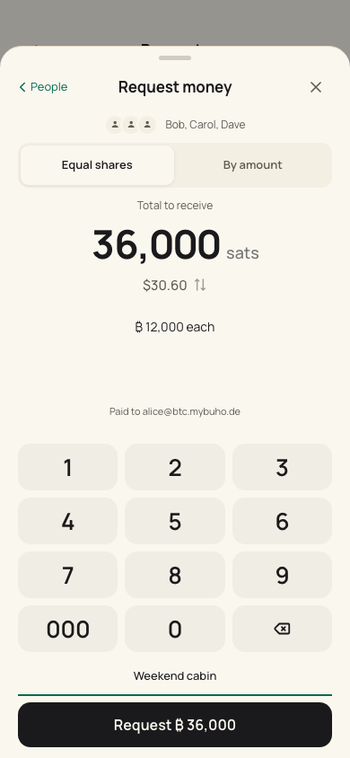
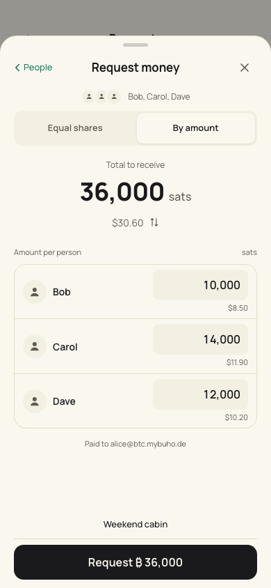
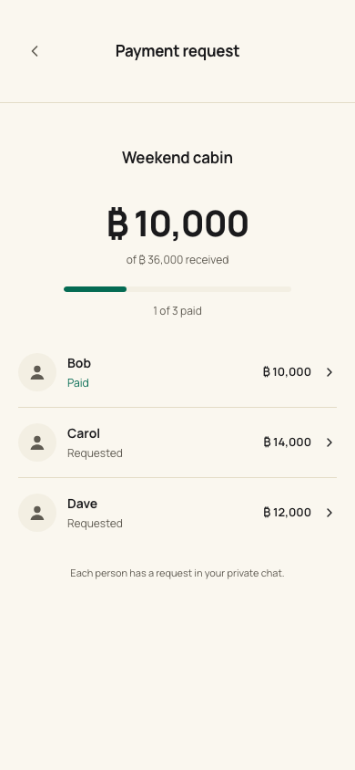
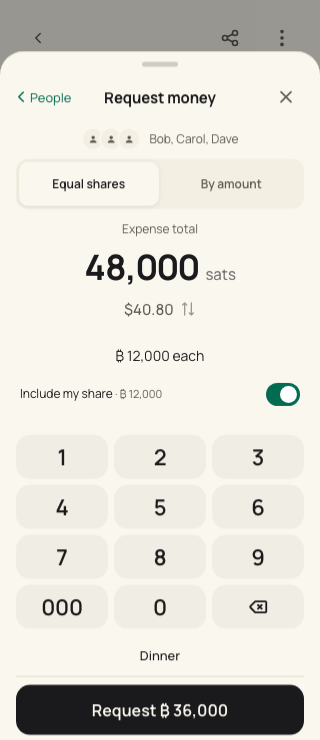
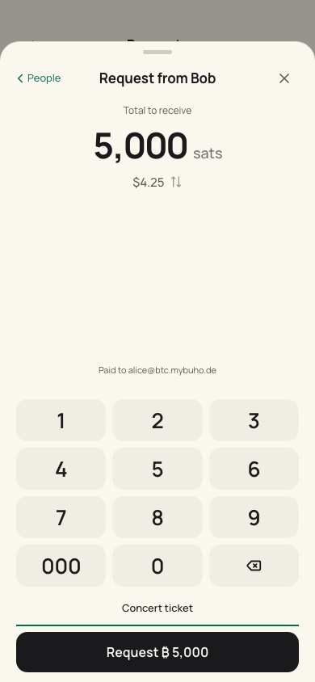
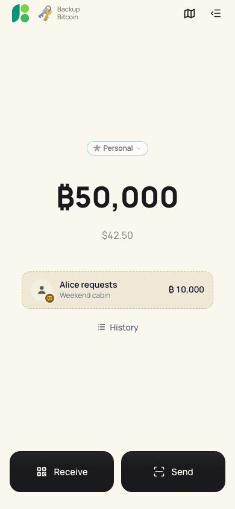
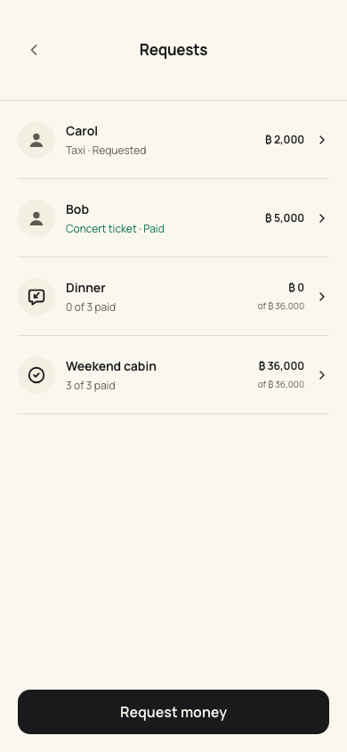

# Shared payment requests

Receive → Request and completed outgoing receipts → Request repayment use
the same people picker and amount sheet. The requester chooses Equal shares
or By amount, optionally adds a note, and sends. Each person receives an
ordinary private request in their own chat; there is no group conversation,
shared wallet, or disclosure of the other people's shares. With one person,
sending opens the chat with them, as a chat request always did; with several,
their progress opens. Both appear under Receive → Requests.

Equal shares divide a direct request's total among the chosen people. A
repayment starts from the original recipient amount, excluding network fees,
and includes the requester by default. Individual amounts determine a direct
request's total; for a repayment, the requester covers what remains. Turning
off the requester's share requires assigning the whole repayment amount.
Calculations use whole sats, distribute every remainder deterministically,
and reject incomplete, duplicate, excessive, or overallocated shares.
Fiat is an entry convenience: the rate is captured for the draft and the
request is denominated in sats. Changing display units alone never changes
an assigned amount.

## Code boundaries

- `utils/requestAllocation.js`: allocation, validation, source keys and numeric input.
- `composables/useRequestAllocation.js`: transient amount-sheet draft and retained edits.
- `SharedRequestSheet.vue`, `RequestNote.vue`, `RequestFromSheet.vue`: presentation and input only.
- `RequestMoneyFlow.vue`: identity capture, navigation, address setup and contact saving.
- `services/dm/requestGoals.js`: validated private manifests and resumable sending.
- `stores/messages.js`: encrypted, identity-scoped persistence and protected request history.
- `useRequests.js` and `RequestGoalsPage.vue`: the Requests page, derived from the chat's ledger.
- `stores/messages.js` `requestsToPay`: the one rule for a request that waits for the user.

The interface follows Apple's guidance for [segmented controls](https://developer.apple.com/design/human-interface-guidelines/segmented-controls),
[entering data](https://developer.apple.com/design/human-interface-guidelines/entering-data),
[text fields](https://developer.apple.com/design/human-interface-guidelines/text-fields),
and [sheets](https://developer.apple.com/design/human-interface-guidelines/sheets):
two related choices in one sheet, labeled numeric fields, automatic totals,
one primary action, explicit Back and Close navigation, and 44px input targets.
The existing Quasar/Capacitor UI, icons, themes, safe-area values and payment
confirmation pipeline are reused. English, German and Spanish are translated.

## Requests that need the user

A request waits for the user while a saved contact's request is not paid,
declined, cancelled or expired (`requestsToPay`). Strangers and blocked
senders never count; their requests stay in Messages, as their messages do.
Following Apple's guidance on [badges](https://developer.apple.com/design/human-interface-guidelines/notifications#Badges)
and [lists](https://developer.apple.com/design/human-interface-guidelines/lists-and-tables),
the signal only appears while there is something to act on and leads
straight to it:

- Home: one card above the last transaction, in the chat's open-request
  colours. One request reads "Anna requests" and opens that chat, where Pay
  is; several read "3 requests to pay" and open the Requests page. Muted
  chats stay quiet, amounts follow Hide balance, and the card disappears as
  soon as nothing waits.
- Receive → Requests: "To pay" first, then everything the user asked for:
  goals and requests sent from inside a chat. One person opens the chat,
  several open their progress.
- The existing message notification still announces each new request.

## Delivery and persistence

A goal contains an owner, its original expense reference when applicable,
its total and own share, and an individual template and stable rumor id for
each person. `nostr-core.createRumor` produces those references; encryption
and delivery still use the existing chat signer and NIP-59 implementation.
A random nonce makes separate requests in the same second distinct.

The complete manifest is encrypted and flushed before the first send. Each
message and its durable outbox also precede publication. A retry resumes the
saved template or existing outbox item, retaining the same request id.
Concurrent submissions share one operation. One identity has at most one
goal for each wallet/transaction pair. Partial delivery is visible per person
and only missing/failed requests are retried. A signer refusal stops the batch.
Identity changes abort old work before it can write into the new scope.

Message state version 2 adds the manifests and migrates version 1. Goal
requests, status evidence and settlements are protected from chat pruning.
Restarting this installation restores its saved goals and delivery state.
The first release stores manifests locally in the encrypted chat database;
they are not reconstructed from relay history or included in Google Drive
wallet/seed backups. Wallet and identity recovery alone therefore does not
restore goal progress on another device. Guest links, cross-device manifest
sync and real Nostr groups remain separate work.

## Payment verification

A payer's message alone never advances a goal. When a goal asks several
people, equal amounts are common, so amount/time matching is insufficient.
Their claims must match an exact payment hash/preimage in the requester's
own incoming ledger, or a validated LUD-21 receipt from their payment
address. A goal with one person follows the chat request rule below. Hash-only
payment announcements support wallets that omit a preimage, including NWC.
The optional `payment_hash` tag is additive to the existing protocol; older
clients still read the amount, note and fallback text. Ordinary chat requests
and one-person goals retain their existing amount/time fallback.

One receipt settles at most one request, including when two wallet connections
expose the same transaction, or the same wallet serves different local identities. Unverified announcements show Checking payment
and contribute zero to progress. If the wallet/service cannot confirm an
announcement, it remains checking until evidence becomes available through
the existing reconciliation and retry schedule.

Request again on an expired goal share creates a signed replacement and
keeps prior request references for late payments. The additive `replaces`
tag closes the old card for clients that support it, and paying either
version prevents paying the other within this app. Payments of different
versions count once toward the share. An invoice already copied outside
the app cannot be revoked; a duplicate/late payment still appears in the
receiving wallet's history and never increases the goal beyond its target.

## Validation

`npm test` includes allocation, retained input, durable sending, double
submission, partial delivery, storage failure, identity switching, encrypted
restart, pruning, renewal, hash-only announcements and exact receipt matching.
The existing chat, signer, wallet and backup checks remain part of the suite.

`npm run check:shared-requests` (app on port 9017, or
`SHARED_REQUESTS_BASE_URL`) runs the real app with isolated test identities, a NIP-17
relay simulator, a NIP-47 wallet simulator, and real signed Lightning invoice
fixtures. No production wallets, relays or funds participate. It covers both
request methods, NWC/Spark payment confirmation, requester/payer privacy,
progress, receipt fee exclusion, dark mode, locale formatting and small screens.

## Reviewed screens

Screenshots from the native browser review (test identities and amounts):

| Equal shares | Individual amounts |
| --- | --- |
|  |  |

| Verified progress | Repayment from an outgoing transaction |
| --- | --- |
|  |  |

| One person | A request waits on the home |
| --- | --- |
|  |  |

| Requests, including ones sent from a chat |
| --- |
|  |
