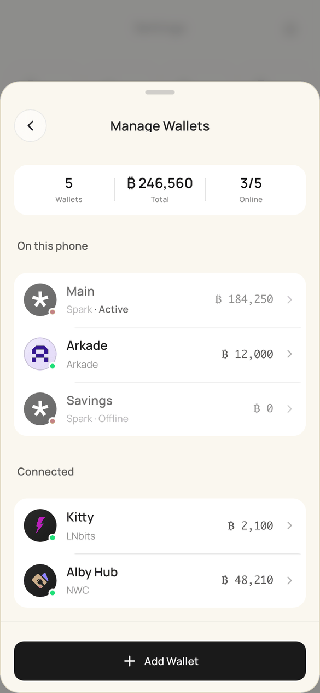
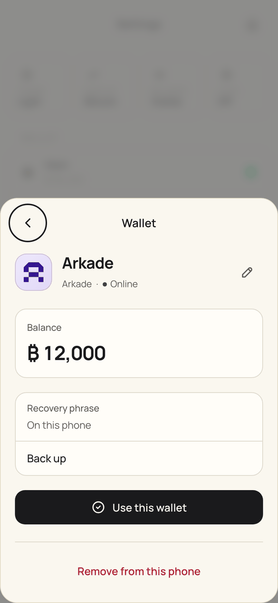
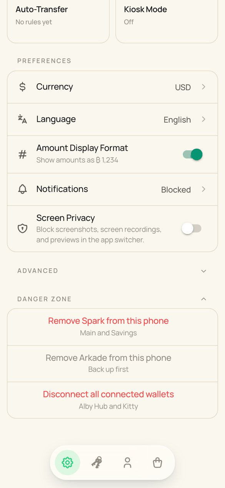
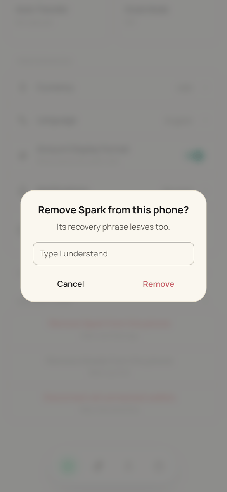

# Taking a wallet off this phone

BuhoGO never deletes a wallet. It is an interface to wallets that live on their own network or service, so what leaves the phone depends on what the phone holds:

| Kind | Wallets | Verb | What leaves | What stays |
|---|---|---|---|---|
| On this phone | Spark, Arkade | **Remove from this phone** | the wallet, and its recovery phrase when it is the last one using it | the money, on its network; the phrase brings it back |
| Connected | NWC, LNbits | **Disconnect** | the connection | the wallet and its money, in its own app or server |

"Delete", "permanently", "cannot be undone" and a trash icon are never used.

## Where it happens

- **Manage Wallets** lists wallets in two groups, *On this phone* and *Connected*. One wallet leaves from its own details: the last row is *Remove from this phone* or *Disconnect*. Wallets on this phone show a *Recovery phrase* row (*Backed up*, or a *Back up* action). Connected NWC wallets say where to revoke the connection.
- **Settings → Danger Zone** (inline, collapsed) has only whole-kind actions: *Remove Spark from this phone*, *Remove Arkade from this phone*, *Disconnect all connected wallets*. Each row names the wallets it covers. A row that cannot run yet is muted and says why (*Back up first*); tapping it offers the way out.

## Rules (utils/walletRemoval.js)

`removalCheck` decides; the store enforces it in `removeWallet` and `removeSparkFromDevice`, and the screens only word it.

- Connected wallets: nothing blocks a disconnect.
- Nothing on this phone leaves during an emergency exit or while an on-chain deposit waits.
- A Spark wallet that is not the last goes only once the network has just shown it empty.
- The last Spark wallet, and an Arkade wallet, take their recovery phrase with them. They go once that phrase is backed up; an Arkade wallet just shown empty may also go without one.

## Asking

One flow for both entry points (`askToRemove` in Settings):

- A plain alert: a title and one short sentence, e.g. *Disconnect Alby Hub?* / *Your money stays in Alby Hub.*
- Typing *I understand* only when a recovery phrase leaves this phone.
- When the kiosk takes payments into the wallet: *The kiosk stops taking payments.* joins the sentence.
- A blocked removal shows one reason and the step that unblocks it. *Back up now* opens Security on that wallet's phrase (`/security?open=backup&wallet=<id>`); *Move funds* opens the transfer.

## Afterwards

Every removal runs through `_removeWalletEntry` and `_afterWalletsRemoved`: running work for the wallet stops, its cached history and auto-transfer rule go, the kiosk binding is cleared, and a remaining wallet becomes active and default. With no wallet left, the app returns to the start.

## Checking

- `node --test src/utils/__tests__/sparkAccounts.spec.js src/stores/__tests__/sparkWallets.spec.js`
- `node scripts/check-remove-disconnect.mjs` (dev server on port 9031) walks every screen and alert and writes screenshots to `output/remove-disconnect-check/`.

| Manage Wallets | Details | Danger Zone | Typed |
|---|---|---|---|
|  |  |  |  |
